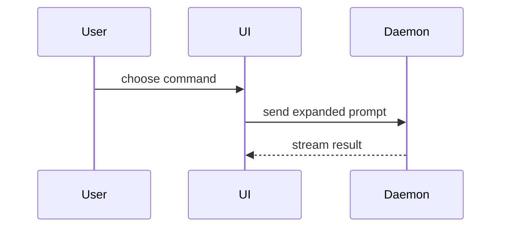

Help the user understand the current topic of conversation visually. Skip the preamble and keep prose brief. Pick the smallest view that makes the key point clear.

A visual is evidence-shaped communication, not a collage. One visual supports one claim. If the answer has several claims, split them into separate visuals or keep the extra claims in prose.

Before drawing, state the claim and classify elements as **observed**, **inferred**, **proposed**, **unresolved**, or **residual risk** when those statuses differ. Show ownership boundaries explicitly; do not let color, proximity, or an unlabeled arrow imply proof.

If the user requires one visual and no prose for multiple claims, honor that format by making the figure's single meta-claim explicit inside it. Partition the content, place the claim and status labels inside the figure, and mark every cross-status relation as `inference`, `hypothesis`, or `[NOT ESTABLISHED]`. Treat fixes as **proposed** unless implementation evidence exists. Never use proof-like arrows from observed content to inferred or proposed content.

Render proposed fixes with an explicit `NOT IMPLEMENTED` label and non-assertive or dashed styling so the figure cannot make a proposal look shipped.

Example:

```text
Claim: retry re-enters the write path.
request --retry--> write
```

The arrow shows the claimed path only. Put the log line that proves the retry beside it, and keep a proposed idempotency change outside this figure.

- Show logic or an algorithm as pseudocode:

```text
on(save)
  if content is unchanged
    return cached result
  write new content
  return fresh result
```

- Show runtime control flow as a call tree:

```text
submitForm
  createSession
    persistPrompt
    launchAgent
  navigateToSession
```

- Show UI structure as a component tree, including state and module boundaries that matter:

```tsx
<SessionPage> (apps/example/src/routes/session.tsx)
  useSessionEvents()
  <SessionToolbar>
    <RunSkillButton> (packages/ui)
```

- Show file responsibility or a broad refactor as a shallow file tree:

```text
src/
├── commands/       # parses user actions
├── sessions/       # owns session state
└── transport/      # sends API requests
```

- Show component interaction, control flow, or data flow with Mermaid:



- Use `diff` when the point is what changes and the surrounding shape already exists. Match the diff shape to the topic.

For a component change:

```diff
 <SessionPage>
   useSessionEvents()
   <SessionToolbar>
+    <RunSkillButton />
   <SessionTimeline>
+    <SkillResultCard />
```

For a file-layout change:

```diff
 src/
 ├── commands/
+│   └── show-me.ts       # expands the slash command
 ├── sessions/
-└── transport.ts
+└── transport/
+    ├── client.ts
+    └── stream.ts
```

For a call-tree or call-stack change:

```diff
 submitForm
   createSession
     persistPrompt
+    expandSkillMention
     launchAgent
-  navigateToSession
+  navigateToSession
+    subscribeToEvents
```

For a state or control-flow change:

```diff
 on(save)
-  write content
+  if content is unchanged
+    return cached result
+  write new content
+  invalidate cache
```

- Show the whole block when most of it is new, when omitted context would hide ownership or order, or when the user needs a copyable target shape:

```ts
function expandSkill(command: string): string {
  const skillName = command.slice(1)
  return `use the ${skillName} skill`
}
```

- For a visual UI, layout, state comparison, or concept too dense for Mermaid, an HTML file is the fallback. Confirm the user wants a file artifact before writing one; an inline diagram answers most questions. When the user agrees to a file: write it outside the repository (OS temporary directory) unless the user names a location, label sample data as illustrative, escape any repository-derived text, and open it for the user:

```
Bash(open path/to/show-me-{description}.html)
```

### guidance

Place each visual next to the short text it supports. Keep only the calls, files, props, states, and boundaries needed to answer the user's current question or the options to resolve the current discussion point.

You may use one of these, you may use several, it is unlikely you will use all of them. Use your judgement and don't overwhelm the user.
